# Secure SPA Architecture
## Backend for Frontend, Server-Side OAuth, YARP, mTLS, and Reusable Security Components

## Purpose

This document describes a security-focused architecture for Single Page Applications (SPAs) built with frameworks such as Vue, React, Angular, or other browser-based JavaScript frameworks.

The architecture uses:

- A same-origin Backend for Frontend (BFF)
- Server-side OAuth/OIDC token management
- Secure browser sessions
- ASP.NET Core
- YARP as a constrained reverse proxy
- Backend-owned business authorization
- Optional mutual TLS (mTLS) for server-to-server workload identity
- Optional certificate-bound OAuth tokens for higher-assurance environments
- Independently reusable security packages

The primary objectives are:

1. Keep OAuth access and refresh tokens out of browser JavaScript.
2. Treat the browser as an untrusted presentation environment.
3. Maintain business authorization at the resource-owning API.
4. Constrain which downstream systems a BFF can reach.
5. Authenticate server-to-server workloads when additional assurance is useful.
6. Keep the architecture simple enough to understand, test, and operate.
7. Allow individual security capabilities to be adopted independently.

The central principle is:

> The browser receives a secure application session rather than downstream credentials. The server controls those credentials and downstream connectivity. The resource API controls authorization to the resource it owns.

---

# 1. Threat Model

A SPA executes in a user-controlled browser.

Application security should assume that a user or attacker may be able to:

- Modify the DOM.
- Modify JavaScript state.
- Enable hidden or disabled controls.
- Navigate directly to client-side routes.
- Construct requests without using the application's UI.
- Execute malicious JavaScript through an XSS vulnerability.
- Execute malicious JavaScript introduced through a compromised frontend dependency.
- Read credentials available to JavaScript in the application's origin.

Consequently:

> The SPA is not an authorization boundary.

UI authorization remains valuable for usability.

A user who cannot perform an administrative action should not normally see the corresponding UI.

Changing the DOM, however, must never grant additional authority.

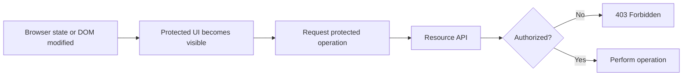

---

# 2. Core Architecture

The preferred architecture introduces a server-side security boundary between the SPA and protected APIs.

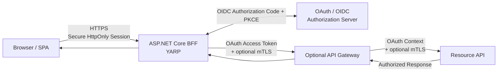

The browser interacts with an application session.

It does not possess the OAuth credentials used by the BFF to reach protected downstream resources.

---

# 3. Security Responsibilities

## SPA

The SPA is responsible for:

- Presentation
- Navigation
- User interaction
- Form input
- Calling same-origin application endpoints
- Displaying authorization information returned by trusted services
- Handling authentication and authorization failures appropriately

The SPA should not possess:

- OAuth access tokens
- OAuth refresh tokens
- OAuth client secrets
- Private client certificates
- Authoritative business authorization logic

The SPA may use authorization information to alter presentation.

For example, it may hide an administrative control when the user does not have the corresponding permission.

That is a user-experience behavior, not a security boundary.

---

## BFF

The BFF is responsible for:

- User authentication
- OIDC Authorization Code flow
- PKCE
- Application session management
- Server-side OAuth token custody
- Access-token acquisition
- Refresh-token handling
- Token refresh
- CSRF protections
- Constrained downstream routing
- Attaching access tokens to downstream requests
- Optional DTO/view mapping
- Optional mTLS workload authentication
- Optional future token exchange

The BFF should not become the authoritative business authorization layer simply because requests pass through it.

---

## API Gateway

Where an API gateway exists, it may perform:

- JWT validation
- Issuer validation
- Audience validation
- Scope validation
- Rate limiting
- Routing
- Infrastructure policy enforcement
- Client-certificate validation
- Telemetry
- Gateway-to-backend workload authentication

Passing gateway validation does not necessarily imply authorization to a particular protected resource.

---

## Resource API

The resource API owns final business authorization.

It is responsible for questions such as:

- Is this identity allowed to perform this operation?
- Is this identity allowed to access this object?
- Which records may this identity see?
- Which fields may this identity see?
- May this identity modify this resource?

The API should never return unauthorized data with the expectation that the SPA or BFF will remove it.

---

# 4. Same-Origin Deployment

A particularly useful deployment model hosts the compiled SPA through the same server that provides BFF functionality.

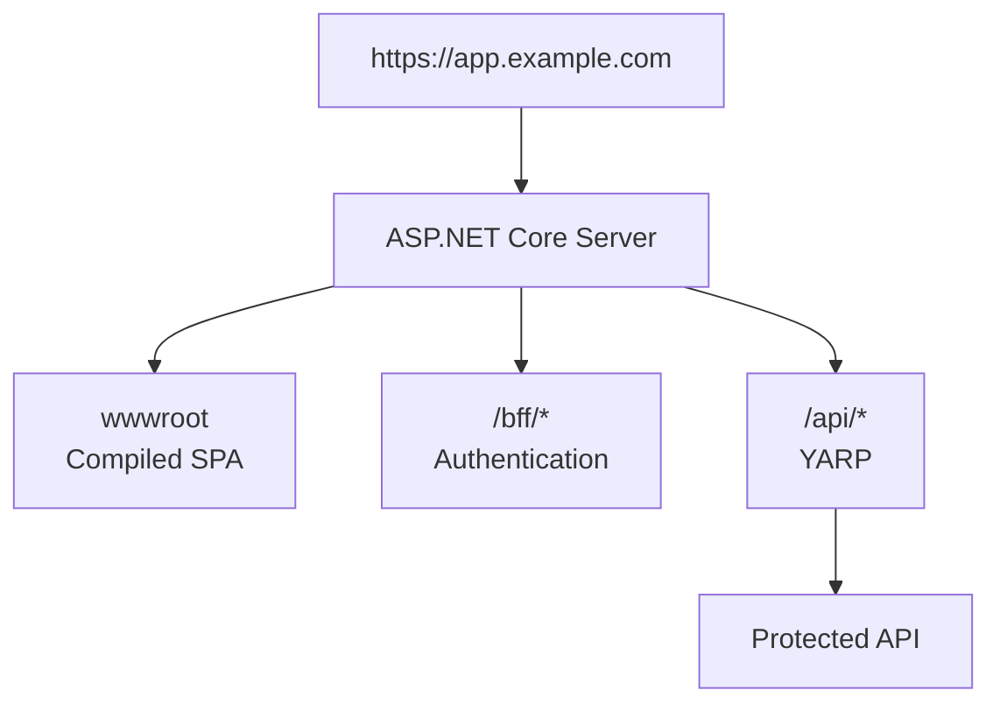

To the browser, normal application traffic remains on one origin:

- `/`
- `/assets/*`
- `/bff/*`
- `/api/*`

This reduces the need for browser-side cross-origin API access.

It does not eliminate the need for CSRF protection.

---

# 5. Authentication Flow

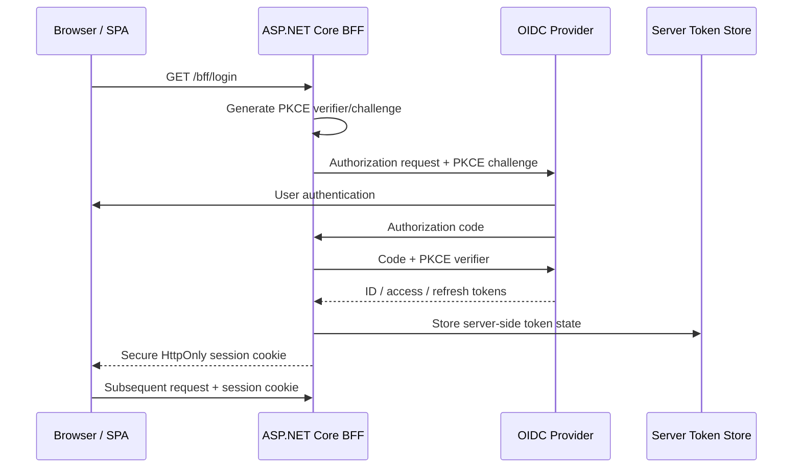

The important separation is:

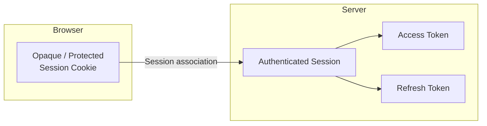

The browser receives the application session.

The server retains OAuth credentials.

---

# 6. Normal API Request

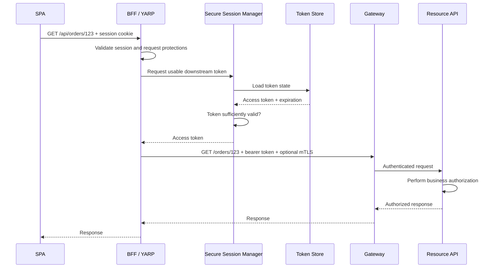

---

# 7. Token Refresh

Token refresh happens server-side.

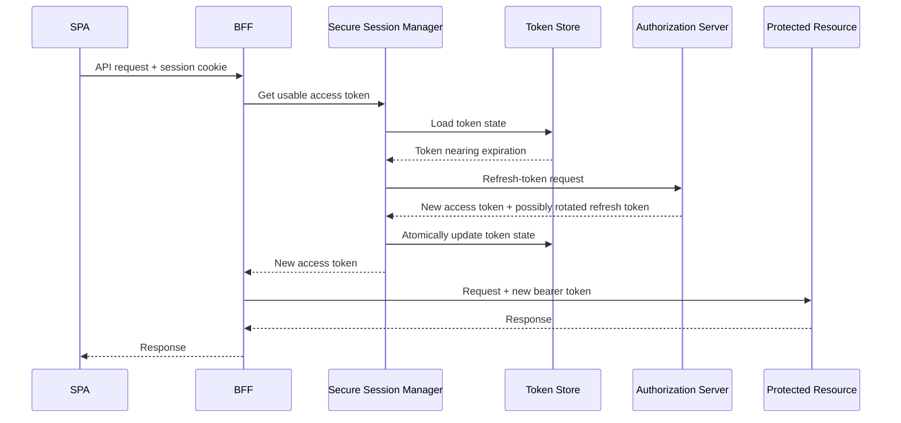

Refresh should normally occur shortly before actual token expiration rather than waiting for an access token to expire during a downstream request.

The refresh window should be configurable.

---

# 8. Concurrent Refresh Protection

SPAs commonly issue multiple requests concurrently.

If a token enters its refresh window, several requests may discover the condition simultaneously.

They should not all attempt refresh.

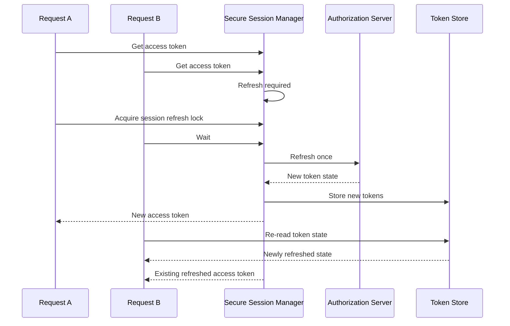

This becomes particularly important when the authorization server performs refresh-token rotation.

A simple single-instance application can initially implement this with a keyed `SemaphoreSlim`.

Distributed deployments require a coordination mechanism appropriate for the selected session/token store.

---

# 9. Secure Session Manager

A useful application abstraction is:

```csharp
public interface ISecureSessionManager
{
    Task<AccessTokenResult> GetAccessTokenAsync(
        ClaimsPrincipal user,
        DownstreamResource resource,
        CancellationToken cancellationToken = default);

    Task RevokeSessionAsync(
        ClaimsPrincipal user,
        CancellationToken cancellationToken = default);
}
```

Supporting models can remain small.

```csharp
public sealed record DownstreamResource(
    string Name,
    string Audience,
    IReadOnlyCollection<string> Scopes);

public sealed record AccessTokenResult(
    string Token,
    DateTimeOffset ExpiresAt);
```

The refresh token should remain internal to the session-management implementation.

```csharp
internal sealed record TokenState(
    string AccessToken,
    string RefreshToken,
    DateTimeOffset AccessTokenExpiresAt);
```

Application infrastructure can request a usable access token.

It does not need arbitrary access to refresh credentials.

---

# 10. Token Store

A simple abstraction is sufficient.

```csharp
internal interface ITokenStore
{
    Task<TokenState?> GetAsync(
        string sessionId,
        CancellationToken cancellationToken = default);

    Task SetAsync(
        string sessionId,
        TokenState state,
        CancellationToken cancellationToken = default);

    Task RemoveAsync(
        string sessionId,
        CancellationToken cancellationToken = default);
}
```

A development implementation can initially use in-memory storage.

Production deployments should consider:

- Horizontal scaling
- Encryption or protection of stored tokens
- Session expiration
- Refresh-token rotation
- Revocation
- Availability
- Cleanup
- Concurrency

Storage technology should follow actual deployment requirements rather than being prematurely abstracted into a large identity platform.

---

# 11. YARP Responsibility

YARP should own proxying.

Application controllers should not repeatedly implement downstream HTTP behavior manually.

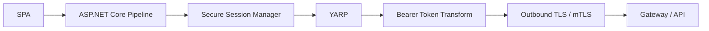

The responsibilities remain separate:

ASP.NET Core authentication:

- Establishes the authenticated browser session.

Secure Session Manager:

- Provides a usable downstream access token.

YARP:

- Routes the request.

YARP transform:

- Attaches the appropriate outbound OAuth credential.

HTTP handler:

- Establishes TLS and optional mTLS workload identity.

Resource API:

- Performs business authorization.

---

# 12. YARP Must Be Constrained

Do not create a generic internal HTTP proxy.

Avoid designs such as:

```text
/api/proxy?target=https://arbitrary-host
```

Instead, destinations should be explicitly configured.

```json
{
  "ReverseProxy": {
    "Routes": {
      "orders": {
        "ClusterId": "orders-api",
        "AuthorizationPolicy": "authenticated",
        "Match": {
          "Path": "/api/orders/{**remaining}"
        }
      }
    },
    "Clusters": {
      "orders-api": {
        "Destinations": {
          "primary": {
            "Address": "https://orders-api.example.internal/"
          }
        }
      }
    }
  }
}
```

Production proxy policies should consider:

- Explicit destination hosts
- Explicit path prefixes
- Allowed HTTP methods
- Authentication requirements
- Downstream OAuth audiences
- Downstream scopes
- Header filtering
- Handling of inbound `Authorization` headers
- Cookies
- Request-size limits
- Response-size limits
- Timeouts
- Redirect behavior
- WebSocket requirements
- Logging
- Correlation identifiers

---

# 13. YARP Token Injection

The browser's request should not supply the downstream bearer token.

The server should obtain and attach it.

Conceptually:

```csharp
var token = await tokenProvider.GetTokenAsync(
    httpContext.User,
    resource,
    cancellationToken);

proxyRequest.Headers.Authorization =
    new AuthenticationHeaderValue(
        "Bearer",
        token.Token);
```

The outbound request becomes:

```http
GET /orders/123 HTTP/1.1
Host: api.example.com
Authorization: Bearer eyJ...
```

The SPA never sees the bearer token.

---

# 14. Backend Authorization

The presence of the BFF does not move business authorization into the BFF.

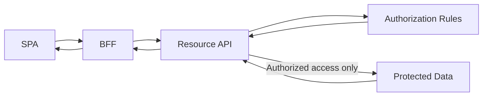

The intended invariant is:

> Unauthorized information never leaves the service that owns it.

A compromised SPA should not obtain additional data.

A compromised presentation rule should not grant additional authority.

A BFF mapping layer should not be responsible for stripping sensitive information that the resource API should never have returned.

---

# 15. CSRF

Moving authentication into a cookie changes the browser threat model.

An `HttpOnly` cookie prevents JavaScript from directly reading the credential.

It does not automatically prevent another site from causing the browser to send a request.

State-changing operations therefore require deliberate CSRF defenses.

Controls should include appropriate use of:

- `Secure`
- `HttpOnly`
- `SameSite`
- Anti-forgery tokens
- Origin validation where appropriate
- Referer validation where appropriate
- Correct HTTP methods

State-changing behavior should not be implemented using `GET`.

---

# 16. 401 and 403

Authentication and authorization failures must remain distinct.

## 401 Unauthorized

The application lacks usable authentication.

Possible causes include:

- Session invalid
- Session expired
- Token refresh failed
- Authentication requirement not satisfied

The application may need to establish a new authenticated session.

## 403 Forbidden

Authentication succeeded, but the identity does not possess the required authority.

The application should display an appropriate unauthorized result.

It should not repeatedly authenticate the user.

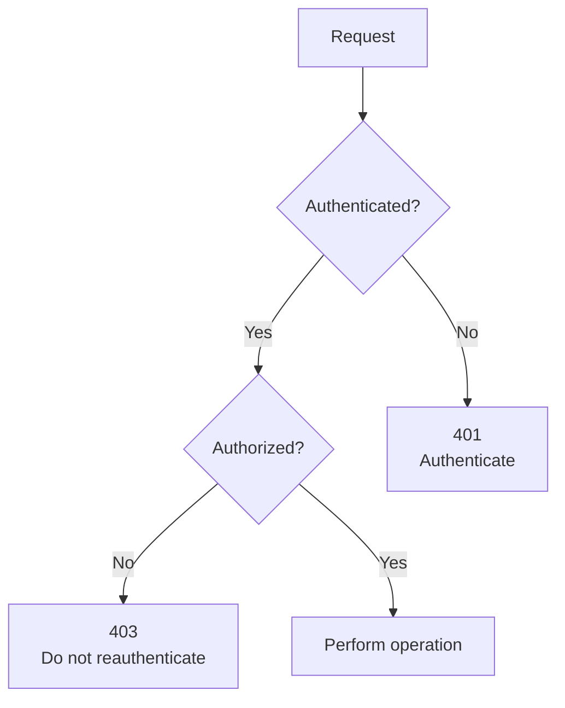

---

# 17. mTLS

mTLS is most useful here as server-to-server workload identity.

The browser should normally not participate.

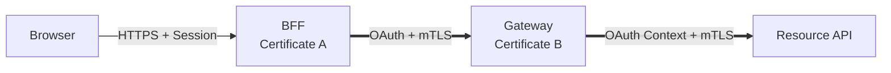

OAuth and mTLS provide different information.

OAuth can answer:

> What user or application authority accompanies this request?

mTLS can answer:

> Which workload established this TLS connection?

This can provide useful defense in depth for sensitive server-to-server boundaries.

---

# 18. Independent mTLS Hops

TLS terminates at each participating server or proxy.

These are therefore separate trust relationships.

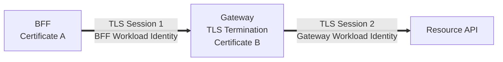

The resource API normally does not see the BFF's client certificate when the gateway terminates the TLS connection.

Instead:

- The gateway authenticates the BFF.
- The resource API authenticates the gateway.

Those may intentionally be different workload identities.

---

# 19. mTLS Does Not Replace OAuth

A valid client certificate proves possession of a workload credential.

It does not inherently answer:

- Which user initiated this operation?
- What OAuth scopes were delegated?
- Which business object may the user access?
- Whether the requested operation is allowed?

Consequently:

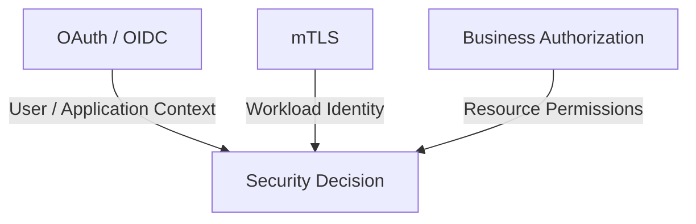

These mechanisms are complementary.

---

# 20. Certificate-Bound OAuth Tokens

For higher-assurance environments, OAuth access tokens may be cryptographically associated with an mTLS client certificate.

RFC 8705 defines this behavior.

Conceptually:

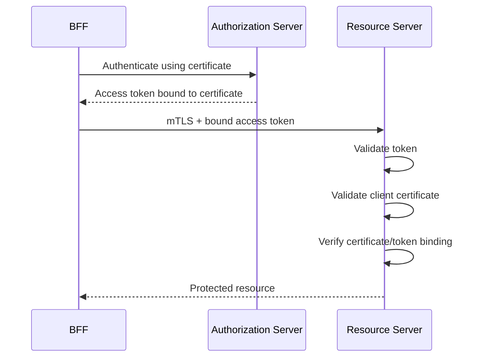

This changes the security characteristics of a stolen access token.

Possessing the token alone is insufficient.

The caller also needs possession of the corresponding certificate's private key.

This is an advanced control.

It should not be treated as a prerequisite for adopting a BFF.

---

# 21. mTLS Certificate Lifecycle

Introducing mTLS also introduces certificate lifecycle responsibilities.

These include:

- Issuance
- Private-key storage
- Trust configuration
- Expiration
- Rotation
- Revocation
- Monitoring
- Deployment
- CA lifecycle management

mTLS should therefore be introduced where the additional workload assurance justifies this operational cost.

Do not add mTLS merely because it is another available security control.

---

# 22. Security Improvement

A traditional browser OAuth architecture can have this property:

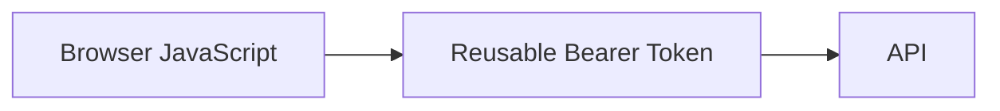

If malicious JavaScript can obtain the bearer credential, it may be possible to replay that credential outside the browser.

The BFF changes the boundary:

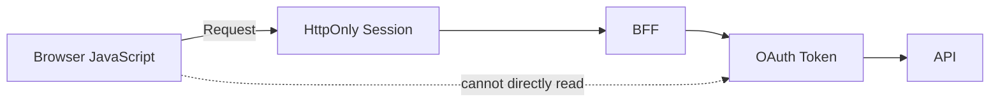

This does not make the browser safe.

Malicious JavaScript may still perform actions through the victim's active session.

The important improvement is narrower:

> Compromising browser JavaScript does not automatically expose the reusable downstream OAuth credential.

---

# 23. Minimal Program Structure

A simple ASP.NET Core implementation can remain small.

```text
Server/
├── Program.cs
│
├── Authentication/
│   ├── ISecureSessionManager.cs
│   ├── SecureSessionManager.cs
│   ├── ITokenStore.cs
│   └── TokenState.cs
│
├── Proxy/
│   ├── DownstreamResources.cs
│   └── AccessTokenTransform.cs
│
├── Certificates/
│   └── IClientCertificateProvider.cs
│
├── wwwroot/
│   └── <compiled SPA>
│
└── appsettings.json
```

The important thing is the separation of responsibilities, not the exact folder structure.

---

# 24. Minimal ASP.NET Core Configuration

A simplified starting configuration might resemble:

```csharp
var builder = WebApplication.CreateBuilder(args);

builder.Services
    .AddAuthentication(options =>
    {
        options.DefaultScheme = "Cookies";
        options.DefaultChallengeScheme = "oidc";
    })
    .AddCookie("Cookies", options =>
    {
        options.Cookie.Name = "__Host-MyApp.Session";
        options.Cookie.HttpOnly = true;
        options.Cookie.SecurePolicy = CookieSecurePolicy.Always;
        options.Cookie.SameSite = SameSiteMode.Lax;
    })
    .AddOpenIdConnect("oidc", options =>
    {
        options.Authority =
            builder.Configuration["Authentication:Authority"];

        options.ClientId =
            builder.Configuration["Authentication:ClientId"];

        options.ClientSecret =
            builder.Configuration["Authentication:ClientSecret"];

        options.ResponseType = "code";
        options.UsePkce = true;

        options.Scope.Add("openid");
        options.Scope.Add("profile");
        options.Scope.Add("offline_access");
    });

builder.Services.AddAuthorization();

builder.Services.AddScoped<
    ISecureSessionManager,
    SecureSessionManager>();

builder.Services
    .AddReverseProxy()
    .LoadFromConfig(
        builder.Configuration.GetSection("ReverseProxy"));

var app = builder.Build();

app.UseHttpsRedirection();

app.UseDefaultFiles();
app.UseStaticFiles();

app.UseAuthentication();
app.UseAuthorization();

app.MapReverseProxy()
    .RequireAuthorization();

app.MapFallbackToFile("index.html");

app.Run();
```

A production system still needs explicit handling for:

- Token storage
- Refresh
- CSRF
- Logout
- Session lifecycle
- Proxy transforms
- Errors
- Observability
- Operational concerns

---

# 25. Framework-Neutral SPA Client

The browser-side API should remain extremely small.

```ts
export interface AuthenticatedUser {
  authenticated: boolean;
  name?: string;
}

export class BffClient {
  async user(): Promise<AuthenticatedUser> {
    const response = await fetch("/bff/user", {
      credentials: "same-origin"
    });

    if (response.status === 401) {
      return {
        authenticated: false
      };
    }

    if (!response.ok) {
      throw new Error(
        `Unable to retrieve user: ${response.status}`
      );
    }

    return response.json();
  }

  login(returnUrl = "/"): void {
    const target = encodeURIComponent(returnUrl);

    window.location.assign(
      `/bff/login?returnUrl=${target}`
    );
  }

  async fetch(
    path: string,
    init: RequestInit = {}
  ): Promise<Response> {
    return fetch(path, {
      ...init,
      credentials: "same-origin"
    });
  }
}
```

The TypeScript client does not know about:

- OAuth access tokens
- Refresh tokens
- OAuth client secrets
- PKCE internals
- JWT parsing
- Client certificates
- mTLS
- Backend URLs

That ignorance is a security property.

---

# 26. Implementation Order

If implementing this architecture for a personal application, build it incrementally.

## Phase 1: Same-Origin BFF

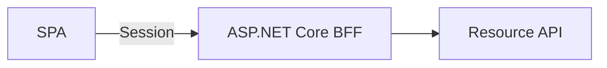

Implement:

- Same-origin SPA hosting
- OIDC login
- Secure session cookie
- Server-side token ownership
- Backend authorization

---

## Phase 2: Constrained Reverse Proxy

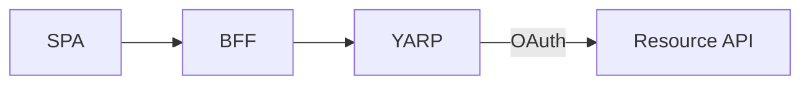

Validate:

- Only configured destinations are reachable.
- Only configured paths are reachable.
- Authentication is required.
- Incoming Authorization headers cannot override server credentials.
- Backend authorization remains effective.

---

## Phase 3: Token Lifecycle

Deliberately test:

- Valid access token
- Expired access token
- Refresh required
- Refresh failure
- Rotated refresh token
- Concurrent requests during refresh
- Session expiration
- Logout and revocation

---

## Phase 4: mTLS

Add mTLS only if the deployment benefits from workload authentication.

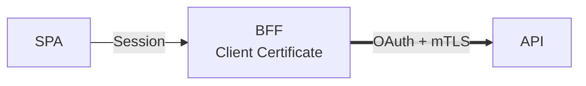

Test:

- Valid token + valid certificate
- Valid token + missing certificate
- Valid token + untrusted certificate
- Invalid token + valid certificate
- Expired certificate
- Certificate rotation
- Broken trust chain

OAuth and mTLS failures should remain independently observable.

---

## Phase 5: Certificate-Bound Tokens

Only if justified, investigate certificate-bound OAuth tokens under RFC 8705.

This is an additional sender-constraining control, not the starting point.

---

# 27. Architectural Invariants

The following should remain true regardless of implementation details.

## Invariant 1

The SPA does not possess OAuth access or refresh tokens.

## Invariant 2

The SPA is not trusted to enforce business authorization.

## Invariant 3

The BFF owns browser authentication session management and OAuth token custody.

## Invariant 4

The service owning protected resources performs final business authorization.

## Invariant 5

YARP can reach only explicitly approved destinations.

## Invariant 6

OAuth authority and mTLS workload identity remain separate concepts.

## Invariant 7

TLS termination creates a new workload trust relationship.

## Invariant 8

Refresh credentials do not escape the token/session management boundary.

## Invariant 9

A `403` does not trigger reauthentication.

## Invariant 10

mTLS is added only when workload authentication provides meaningful security value.

## Invariant 11

The BFF reduces credential exposure but does not eliminate XSS, CSRF, session compromise, or backend vulnerabilities.

## Invariant 12

Every security control should mitigate an identified threat rather than merely increase architectural complexity.

---

# 28. Reusable Package Direction

A long-term goal is to identify portions of this architecture that can become reusable security packages.

The packages should remain independently adoptable.

An application should not need to adopt mTLS because it wants BFF token management.

An application should not need YARP merely because it wants server-side OAuth token custody.

Likewise, an API client, worker, or service should be able to use the mTLS package without using a BFF at all.

The desired model is composition.

```mermaid
flowchart TD
    App["Application"]

    BFF["BFF / Secure Session Package"]
    Proxy["YARP OAuth Proxy Package"]
    MTLS["mTLS Package"]
    SPA["TypeScript SPA Client"]

    App --> BFF
    App --> Proxy
    App --> MTLS
    App --> SPA

    Proxy -. "can use" .-> BFF
    Proxy -. "can use" .-> MTLS
```

---

# 29. Possible Package Structure

The eventual package family could look approximately like this.

```text
NuGet

SecureSpa.Bff
SecureSpa.Yarp
SecureSpa.Mtls


npm

@secure-spa/client
```

These names are placeholders.

The important distinction is the separation of responsibilities.

---

# 30. `SecureSpa.Bff`

Purpose:

Provide secure browser-session and server-side OAuth token-management primitives.

The package could own:

- OIDC configuration helpers
- Authorization Code + PKCE defaults
- Secure application-session configuration
- Server-side access-token storage
- Server-side refresh-token storage
- Token refresh
- Refresh-token rotation
- Concurrent refresh protection
- Logout and revocation hooks
- `ISecureSessionManager`
- `ITokenStore`
- Downstream resource definitions
- Secure session-cookie defaults
- CSRF integration points

It should not depend on YARP.

An application can then use server-side token management even when it makes downstream calls using normal `HttpClient`.

```mermaid
flowchart LR
    Browser["Browser"]

    App["ASP.NET Core Application"]

    BFF["SecureSpa.Bff"]

    Http["HttpClient"]

    API["API"]

    Browser -->|"Session"| App

    App --> BFF

    BFF -->|"Access Token"| Http

    Http --> API
```

---

# 31. `SecureSpa.Yarp`

Purpose:

Connect authenticated BFF sessions to explicitly configured YARP routes.

It could provide:

- YARP request transforms
- OAuth bearer-token injection
- Mapping between routes and downstream resources
- Safe handling of inbound `Authorization` headers
- Route validation
- Authentication requirements
- Logging and correlation
- Explicit downstream audience and scope definitions

```mermaid
flowchart LR
    SPA["SPA"]

    Server["ASP.NET Core"]

    Session["SecureSpa.Bff"]

    YARP["SecureSpa.Yarp"]

    API["Protected API"]

    SPA -->|"Session"| Server

    Server --> Session

    Server --> YARP

    YARP -->|"Request token"| Session

    Session -->|"Usable access token"| YARP

    YARP -->|"Bearer Token"| API
```

The dependency direction should remain:

```mermaid
flowchart LR
    BFF["SecureSpa.Bff"]
    YARP["SecureSpa.Yarp"]

    YARP --> BFF
```

Applications that do not need reverse proxying can stop at the BFF package.

---

# 32. `SecureSpa.Mtls`

Purpose:

Provide reusable server-to-server mTLS support independent of the BFF architecture.

Possible capabilities include:

- Client certificate acquisition
- Certificate-provider abstractions
- `HttpClient` mTLS configuration
- Certificate-validation helpers
- Trust configuration
- Certificate-expiration monitoring
- Certificate rotation integration
- Logging
- Health checks
- Secure defaults

An initial abstraction might resemble:

```csharp
public interface IClientCertificateProvider
{
    Task<X509Certificate2> GetCertificateAsync(
        string identityName,
        CancellationToken cancellationToken = default);
}
```

Possible eventual usage:

```csharp
builder.Services
    .AddHttpClient("OrdersApi")
    .AddMutualTls(options =>
    {
        options.ClientIdentity = "orders-bff";
    });
```

The exact API should come from implementation experience rather than being finalized in advance.

This package should have no requirement for:

- SPA
- BFF
- YARP
- OIDC
- User sessions

For example, a background worker could use it independently.

```mermaid
flowchart LR
    Worker["Background Worker"]

    MTLS["SecureSpa.Mtls"]

    API["Protected API"]

    Worker --> MTLS

    MTLS ==>|"mTLS"| API
```

A BFF could also use it.

```mermaid
flowchart LR
    SPA["SPA"]

    BFF["BFF"]

    MTLS["SecureSpa.Mtls"]

    API["API"]

    SPA --> BFF

    BFF --> MTLS

    MTLS ==>|"OAuth + mTLS"| API
```

mTLS is therefore a workload-security capability rather than a BFF feature.

---

# 33. Combining YARP and mTLS

An application requiring both OAuth token forwarding and workload authentication can compose the packages.

```mermaid
flowchart LR
    SPA["SPA"]

    App["ASP.NET Core Server"]

    Session["SecureSpa.Bff"]

    YARP["SecureSpa.Yarp"]

    MTLS["SecureSpa.Mtls"]

    API["Protected API"]

    SPA -->|"Secure Session"| App

    App --> Session
    App --> YARP

    YARP -->|"Get Access Token"| Session

    Session -->|"Bearer Token"| YARP

    YARP --> MTLS

    MTLS ==>|"Bearer Token + mTLS"| API
```

The resulting downstream request has two independent identities.

OAuth provides:

- User or application authority

mTLS provides:

- Calling workload identity

Neither package should treat those as the same concept.

---

# 34. TypeScript Package

The browser package should remain considerably smaller than the server packages.

Possible package:

```text
@secure-spa/client
```

Its job is not to implement OAuth.

Its job is to provide a consistent browser interface to a BFF.

```ts
export interface AuthenticatedUser {
  authenticated: boolean;
  name?: string;
}

export interface BffClient {
  getUser(): Promise<AuthenticatedUser>;

  login(returnUrl?: string): void;

  logout(): Promise<void>;

  fetch(
    path: string,
    init?: RequestInit
  ): Promise<Response>;
}
```

The browser package should not know about:

- OAuth access tokens
- OAuth refresh tokens
- JWT validation
- Token refresh
- OIDC client secrets
- mTLS
- X.509 certificates
- API credentials

Its value is partly defined by what it does not expose.

---

# 35. SPA Framework Independence

The TypeScript package should ideally not depend on Vue.

```mermaid
flowchart TD
    Client["@secure-spa/client"]

    Vue["Vue"]
    React["React"]
    Angular["Angular"]
    Other["Other TypeScript SPA"]

    Vue --> Client
    React --> Client
    Angular --> Client
    Other --> Client
```

Framework-specific helpers could eventually be layered on top.

For example:

```text
@secure-spa/client
@secure-spa/vue
@secure-spa/react
```

Do not build those wrappers until actual duplication demonstrates their value.

---

# 36. Backend Framework Independence

The HTTP contract between browser and BFF should also avoid unnecessary ASP.NET-specific behavior.

Conceptually:

```text
GET  /bff/user
GET  /bff/login
POST /bff/logout

/api/*
```

A compatible BFF could eventually be implemented using:

- ASP.NET Core
- Node.js / Express
- Spring Boot
- Another server platform

The SPA should not care.

```mermaid
flowchart TD
    SPA["SPA"]

    Contract["BFF HTTP Contract"]

    DotNet["ASP.NET Core"]
    Node["Node.js / Express"]
    Java["Spring Boot"]

    SPA --> Contract

    Contract --> DotNet
    Contract --> Node
    Contract --> Java
```

The initial implementation can still focus entirely on ASP.NET Core.

Cross-platform portability can be preserved architecturally without immediately implementing every platform.

---

# 37. Possible Java Package Direction

If the architecture later proves useful outside .NET, equivalent Java functionality could be packaged as Spring Boot starters.

Possible future packages:

```text
secure-spa-bff-spring-boot-starter

secure-spa-mtls-spring-boot-starter
```

The BFF starter could eventually provide:

- OIDC integration
- Secure sessions
- Server-side token storage
- Token refresh
- Downstream token acquisition

The mTLS starter could provide:

- Keystore configuration
- Truststore configuration
- PKCS#12 support
- Outbound HTTP client configuration
- Certificate lifecycle integrations

This remains a future direction rather than an initial implementation requirement.

---

# 38. Independent Adoption

The packages should support several combinations.

## BFF Only

```mermaid
flowchart LR
    SPA["SPA"]
    BFF["SecureSpa.Bff"]
    API["API"]

    SPA -->|"Session"| BFF

    BFF -->|"OAuth"| API
```

Use when the primary goal is keeping OAuth credentials out of browser JavaScript.

---

## BFF + YARP

```mermaid
flowchart LR
    SPA["SPA"]

    BFF["SecureSpa.Bff"]

    YARP["SecureSpa.Yarp"]

    API["API"]

    SPA -->|"Session"| BFF

    BFF --> YARP

    YARP -->|"OAuth"| API
```

Use when the BFF primarily acts as a secure reverse proxy.

---

## mTLS Only

```mermaid
flowchart LR
    Service["Service"]

    MTLS["SecureSpa.Mtls"]

    API["API"]

    Service --> MTLS

    MTLS ==>|"mTLS"| API
```

Use when workload authentication is required but no SPA or BFF exists.

---

## BFF + mTLS

```mermaid
flowchart LR
    SPA["SPA"]

    BFF["SecureSpa.Bff"]

    MTLS["SecureSpa.Mtls"]

    API["API"]

    SPA -->|"Session"| BFF

    BFF --> MTLS

    MTLS ==>|"OAuth + mTLS"| API
```

Use when the BFF requires both user or delegated authority and workload identity.

---

## BFF + YARP + mTLS

```mermaid
flowchart LR
    SPA["SPA"]

    BFF["SecureSpa.Bff"]

    YARP["SecureSpa.Yarp"]

    MTLS["SecureSpa.Mtls"]

    API["API"]

    SPA -->|"Session"| BFF

    BFF --> YARP

    YARP --> MTLS

    MTLS ==>|"OAuth + mTLS"| API
```

This represents a complete version of the proposed architecture but should not be mandatory.

---

# 39. Certificate-Bound Tokens as an Independent Capability

Certificate-bound OAuth tokens should remain separate from ordinary mTLS support.

There are three distinct configurations.

## OAuth Only

```mermaid
flowchart LR
    Client["Server"]
    API["API"]

    Client -->|"Bearer Token"| API
```

## OAuth + mTLS

```mermaid
flowchart LR
    Client["Server<br/>Certificate A"]
    API["API"]

    Client ==>|"Bearer Token + mTLS"| API
```

The bearer token and workload certificate provide independent security information.

## Certificate-Bound OAuth + mTLS

```mermaid
flowchart LR
    Client["Server<br/>Certificate A"]

    Token["Access Token<br/>Bound to Certificate A"]

    API["API"]

    Client --> Token

    Token ==>|"mTLS + Proof of Possession"| API
```

Here possession of the access token alone is not sufficient.

The client must also demonstrate possession of the corresponding certificate private key.

This could eventually become a separate optional package such as:

```text
SecureSpa.OAuth.MtlsBoundTokens
```

It should not be built directly into `SecureSpa.Mtls`.

Ordinary mTLS has uses completely unrelated to OAuth.

---

# 40. Dependency Direction

A desirable eventual dependency structure is:

```mermaid
flowchart TD
    Core["Small Shared Abstractions"]

    BFF["SecureSpa.Bff"]

    YARP["SecureSpa.Yarp"]

    MTLS["SecureSpa.Mtls"]

    Bound["Optional OAuth mTLS Binding"]

    Client["@secure-spa/client"]

    BFF --> Core

    YARP --> BFF

    MTLS --> Core

    Bound --> BFF
    Bound --> MTLS

    Client -. "HTTP contract only" .-> BFF
```

Avoid creating a package equivalent to:

```text
SecureSpa.Everything
```

that requires applications to install every feature.

Security capabilities should remain composable.

---

# 41. Configuration Should Express Intent

Applications should configure security in application terms rather than manipulate certificates and tokens throughout application code.

Possible eventual BFF configuration:

```csharp
builder.Services
    .AddSecureBff(options =>
    {
        options.Session.CookieName = "__Host-MyApp";
        options.RefreshWindow = TimeSpan.FromMinutes(2);
    })
    .AddDownstreamResource(
        "orders",
        options =>
        {
            options.Audience = "https://api.example.com/orders";
            options.Scopes = ["orders.read", "orders.write"];
        });
```

An application choosing YARP could add:

```csharp
builder.Services
    .AddSecureYarp()
    .AddAuthenticatedRoute(
        "orders",
        resource: "orders");
```

An application choosing mTLS could independently add:

```csharp
builder.Services
    .AddMutualTlsClient(
        "orders",
        options =>
        {
            options.ClientIdentity = "orders-web";
        });
```

These APIs are illustrative.

They should be finalized only after concrete implementations reveal the appropriate abstractions.

---

# 42. Secure Defaults

If reusable packages are created, their primary value should not only be reducing boilerplate.

They should make the secure implementation the easiest implementation.

## BFF Defaults

The BFF package should default toward:

- `HttpOnly` cookies
- `Secure` cookies
- Safe `SameSite` behavior
- PKCE
- Server-side token custody
- Refresh-token encapsulation
- Anti-forgery integration
- Short-lived access-token handling
- Explicit downstream resources

## YARP Defaults

The YARP package should default toward:

- Authentication required
- Explicit destinations
- Explicit route mappings
- Replacing rather than trusting browser-supplied authorization headers
- Safe forwarding behavior
- No arbitrary destination proxying

## mTLS Defaults

The mTLS package should default toward:

- Certificate validation
- Controlled trust
- No disabled certificate-validation callbacks
- Expiration monitoring
- Rotation-friendly certificate providers
- Appropriate private-key protection

Secure behavior should require less application code than insecure behavior.

---

# 43. Package Extraction Rule

Do not start by building all of these packages.

Start with a real application.

The extraction sequence should be:

```mermaid
flowchart TD
    App1["Implement Secure Application #1"]

    Learn["Learn Actual Requirements"]

    App2["Implement Secure Application #2"]

    Duplicate["Identify Real Duplication"]

    Extract["Extract Reusable Package"]

    Harden["Harden and Test Package"]

    Reuse["Reuse Across Applications"]

    App1 --> Learn
    Learn --> App2
    App2 --> Duplicate
    Duplicate --> Extract
    Extract --> Harden
    Harden --> Reuse
```

A useful rule is:

> The first application discovers the pattern. The second application proves that the pattern repeats. Only then does the repeated behavior deserve a package.

This prevents the security architecture from becoming a framework-design project before the underlying implementation has been validated.

---

# 44. Testing Strategy

Each security mechanism should be independently testable.

## Session Tests

Test:

- No session
- Valid session
- Expired session
- Invalid session
- Logout
- Cookie security attributes
- CSRF protection

## OAuth Tests

Test:

- Valid token
- Expired token
- Wrong audience
- Wrong issuer
- Missing required scope
- Successful refresh
- Failed refresh
- Refresh-token rotation
- Concurrent refresh

## Proxy Tests

Test:

- Approved destination
- Unapproved destination
- Approved route
- Unapproved route
- Allowed method
- Disallowed method
- Browser-supplied Authorization header
- Redirect behavior
- Timeout behavior

## mTLS Tests

Test:

- Trusted certificate
- Missing certificate
- Untrusted certificate
- Expired certificate
- Wrong certificate
- Broken chain
- Certificate rotation

## Authorization Tests

Test:

- Authorized identity
- Unauthorized identity
- Unauthorized object
- Unauthorized operation
- Manipulated SPA state
- Direct API requests bypassing UI behavior

Security boundaries should fail independently.

---

# 45. Observability

Security infrastructure that cannot explain failures becomes difficult to operate.

The system should distinguish events such as:

- Browser session missing
- Browser session expired
- CSRF validation failed
- Access token unavailable
- Token refresh required
- Token refresh succeeded
- Token refresh failed
- Downstream OAuth validation failed
- mTLS handshake failed
- Client certificate rejected
- Backend authorization denied
- Downstream timeout
- Proxy route rejected

Sensitive values must not be logged.

In particular, logs should never contain:

- Access tokens
- Refresh tokens
- Client secrets
- Private keys
- Session-cookie values

Logs should contain enough correlation information to follow a request across the BFF, gateway, and API without exposing credentials.

---

# 46. Long-Term Goal

The long-term goal is not a universal web application framework.

It is a small collection of security primitives that make secure SPA architectures easy to assemble.

A future application should be able to make independent choices:

```text
Need server-side OAuth token custody?

    Add the BFF capability.


Need authenticated reverse proxying?

    Add the YARP capability.


Need workload identity?

    Add the mTLS capability.


Need a simple SPA/session client?

    Add the TypeScript capability.


Need certificate-bound OAuth?

    Add it explicitly as an advanced capability.
```

That modularity is important.

A simple SPA should not inherit certificate-management complexity merely because it wants OAuth tokens kept out of JavaScript.

A background worker should not require BFF dependencies merely because it needs mTLS.

A SPA should not understand OAuth internals simply because its server uses OAuth.

Each security concern remains independently understandable, testable, and deployable.

---

# 47. Final Package Philosophy

The reusable architecture preserves several independent security concepts.

```mermaid
flowchart LR
    Browser["Browser Security"]

    Session["Session / Token Security"]

    Proxy["Downstream Request Security"]

    Workload["Workload Identity"]

    Resource["Resource Authorization"]

    Browser --> Session

    Session --> Proxy

    Proxy --> Workload

    Workload --> Resource
```

They correspond approximately to:

| Concern | Potential Package |
|---|---|
| Browser interaction | `@secure-spa/client` |
| Session and OAuth custody | `SecureSpa.Bff` |
| Controlled reverse proxying | `SecureSpa.Yarp` |
| Workload identity | `SecureSpa.Mtls` |
| Certificate-bound OAuth | `SecureSpa.OAuth.MtlsBoundTokens` |
| Business authorization | Resource application itself |

The packages help applications establish and transport trustworthy security context.

They do not replace the resource application's responsibility to decide what the current identity is allowed to do.

---

# 48. Target Architecture

```mermaid
flowchart TB
    subgraph BrowserBoundary["Untrusted Browser Boundary"]
        SPA["SPA<br/>Vue / React / Angular"]
        Client["@secure-spa/client"]
        SPA --> Client
    end

    subgraph ServerBoundary["Application Server Boundary"]
        BFF["Secure BFF / Session"]
        Session["Secure Session Manager"]
        YARP["Constrained YARP Proxy"]

        BFF --> Session
        BFF --> YARP
    end

    subgraph WorkloadBoundary["Optional Workload Security"]
        MTLS["mTLS Client Identity"]
    end

    subgraph Infrastructure["Optional API Infrastructure"]
        GW["API Gateway"]
    end

    subgraph ResourceBoundary["Resource Security Boundary"]
        API["Resource API"]
        AUTHZ["Authorization Policy / Data"]

        API <-->|"Authorization"| AUTHZ
    end

    IDP["OAuth / OIDC Authorization Server"]

    Client -->|"HTTPS<br/>Secure HttpOnly Session"| BFF

    BFF <-->|"Authorization Code + PKCE"| IDP

    YARP -->|"OAuth Access Token"| MTLS

    MTLS ==>|"OAuth + optional mTLS"| GW

    GW ==>|"OAuth Context + optional mTLS"| API

    API -->|"Authorized Data Only"| GW

    GW --> YARP

    BFF --> Client
```

Not every application needs every box.

A simpler application may use:

```mermaid
flowchart LR
    SPA["SPA"]
    BFF["BFF"]
    API["API"]

    SPA -->|"Session"| BFF
    BFF -->|"OAuth"| API
```

A service with no browser may use:

```mermaid
flowchart LR
    Service["Service"]
    MTLS["mTLS"]
    API["API"]

    Service --> MTLS
    MTLS --> API
```

The architecture should scale by composition rather than by requiring every security capability everywhere.

---

# 49. Summary

The architecture is based on clear security boundaries.

Browser:

- Presentation
- User interaction
- Secure application session
- No downstream OAuth credentials

BFF:

- Authentication
- Session management
- OAuth token custody
- Token refresh
- Controlled downstream access

YARP:

- Explicit reverse proxying
- Constrained destinations
- Server-controlled bearer-token attachment

OAuth/OIDC:

- User or application identity
- Delegated authority
- Scope and audience

mTLS:

- Optional cryptographic workload authentication
- Independent of OAuth
- Independently reusable by BFFs, APIs, background workers, and other services

Certificate-bound OAuth:

- Optional higher-assurance sender-constrained access tokens
- Separate from ordinary mTLS
- Added only when justified

Resource API:

- Authoritative business authorization
- Object-level access
- Operation-level access
- Data protection

The guiding principle is:

> Keep powerful credentials out of the browser, constrain where authenticated requests can go, authenticate server workloads when the threat model justifies it, and enforce authorization at the resource that owns the protected data or operation.

The package-design principle is:

> Make the security capabilities composable. BFF token management, YARP proxying, mTLS workload identity, and certificate-bound OAuth should be independently adoptable rather than bundled into a single mandatory framework.

And the implementation principle is:

> Build the concrete secure application first. Extract reusable packages only after real implementations demonstrate which abstractions actually repeat.

---

# Public Standards and Technologies

This architecture is based entirely on public security patterns, standards, and technologies, including:

- OAuth 2.0
- OpenID Connect
- OAuth Authorization Code flow
- PKCE
- Backend for Frontend architecture
- RFC 10017, OAuth 2.0 for Browser-Based Applications
- RFC 8705, OAuth 2.0 Mutual-TLS Client Authentication and Certificate-Bound Access Tokens
- TLS and mutual TLS
- ASP.NET Core
- Microsoft YARP
- Standard browser cookie and same-origin security mechanisms
